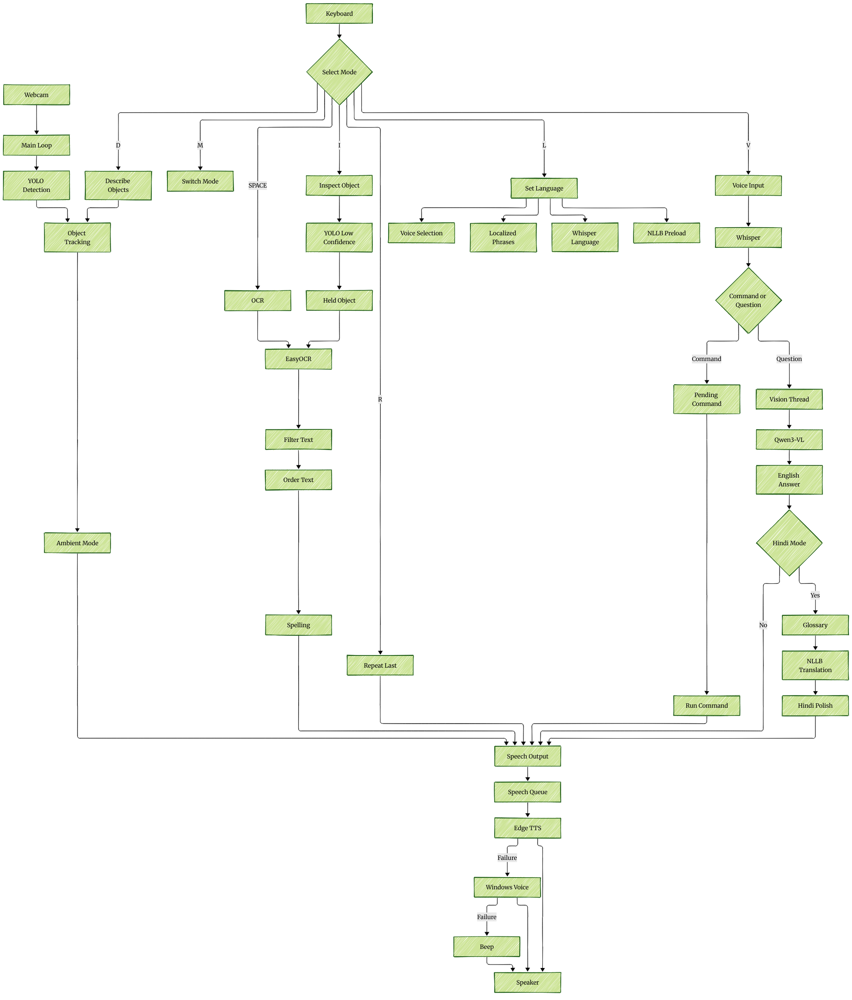

# VisionAssist — Architecture

How the application is built, why it is built that way, and the rules that keep
it working. Written for a developer seeing the project for the first time, or
returning to it months later.

**Source of truth:** the code. Every statement here was checked against it.
Reasons for decisions come from [devlog.md](devlog.md), cited by day. Where a
reason is not recorded anywhere, this document says so.

**Scope:** a single Windows desktop application, one Python process. There is
no server, database, login or deployment. The only stored data is
`evaluation/results.csv`. **There are no automated tests**; evaluation is
manual, using the scripts in `src/evaluation/`.

---

## 1. System overview

A webcam feed is checked for objects on every frame, and objects that newly
appear are spoken aloud. On request, the application also reads text, names a
held-up object, takes spoken commands, and answers open questions about what
the camera sees, in English or Hindi. A video window shows the camera with
captions of everything spoken, for the sighted people around the user.

How to read it:

- **Left:** the webcam feeds the main loop, which runs YOLO on every frame.
  Tracking remembers what is present, and in ambient mode newly appeared
  objects are announced.
- **Top:** each key starts one path. SPACE reads all text; I runs detection
  again at a lower threshold, picks the held object and reads a few words on
  it; D describes what is tracked; R repeats; M and L switch mode and
  language; V records speech.
- **Right:** Whisper turns speech into text. A command is run by the main
  loop, exactly as its key would; anything else is a question for the vision
  model, which answers in English and, in Hindi mode only, is translated.
- **Bottom:** every path ends in the speech queue, which uses the online
  voice, falls back to the Windows voice, and beeps if both fail twice in a
  row.

---

## 2. Components

| File | Responsible for | Inputs | Outputs | Depends on |
|---|---|---|---|---|
| `src/assistant/main.py` | The application: settings, startup, camera loop, modes, keys, voice-command dispatch, object tracking, held-object choice, OCR clean-up, failure handling | Camera frames, key presses, transcribed text | Speech requests, the video window | Every module below |
| `src/speech/tts.py` | `Speaker`: a queue and one worker thread that speaks; priority, expiry and merging; online voice with offline rescue | `speak(text, priority, expires_in)` | Audio | edge-tts, pygame, pyttsx3 |
| `src/voice/listener.py` | `VoiceListener`: always-open microphone, push-to-talk recording, Whisper transcription; `match_command()` and the `COMMANDS` table | Microphone audio, language | Transcribed text, a command name | openai-whisper, sounddevice, numpy |
| `src/vision/asker.py` | `VisionAsker`: sends a frame and question to the vision model, in the background; translates the answer in Hindi mode | Frame, question, language | `(answer, None)` or `(None, problem_code)` through a callback | ollama, opencv, translator |
| `src/language/translator.py` | `HindiTranslator`: NLLB-200 on the CPU; the glossary; `polish_hindi()` | English text | Hindi text, or `None` | transformers, sentencepiece, torch |
| `src/language/phrases.py` | Every fixed sentence the app speaks, in English and Hindi (34 keys, both complete) | Key, language, values | A sentence | — |
| `src/language/spelling.py` | Decides whether an OCR word may be spelling-corrected (look-alike letters only) | Word, confidence, spell checker | Word to speak | pyspellchecker (passed in) |
| `src/display/hud.py` | `Hud`: everything drawn on the video: captions, status pills, key strip, detection boxes, the identified-object highlight | Frame, detections, state | The frame, drawn on | Pillow, opencv, numpy, shaping |
| `src/display/shaping.py` | `ShapedFont`: shapes Devanagari with HarfBuzz and draws it with FreeType when Pillow lacks Raqm | Text, font file | An RGBA image of the text | uharfbuzz, freetype-py |
| `src/bidi/__init__.py` | A stand-in for `python-bidi`, which EasyOCR imports; returns text unchanged | Text | The same text | — |
| `setup.py` | One-command install: checks, `.venv`, packages, OpenCV repair, verification, model downloads, report | Command-line options | An installed environment | pip, the app's modules (for model names) |
| `src/evaluation/` | Manual evaluation, two sets: `record_results.py` / `analyse_results.py` for the 86-test feature evaluation, and `record_room_sweep.py` / `analyse_room_sweep.py` for the 31-object room sweep; three dated correction scripts; `check_glossary.py` and `check_spelling.py` | Tester's verdicts; app modules | `evaluation/results.csv`, `evaluation/room_sweep.csv`, reports | The app's modules |
| `archive/` | **Legacy.** Earlier standalone scripts (detection, Tesseract and EasyOCR, voice and translation tests), kept because the devlog refers to them. Not run by the app; `archive/detection/detect.py` loads a model no longer in the repository | — | — | — |

---

## 3. Threads

| Thread | Started by | Count | Does | How results get back |
|---|---|---|---|---|
| **Main loop** | `main.py` | 1 | Reads the camera, runs detection, tracks objects, draws, reads keys, runs pending commands | Owns `mode`, `language`, `current_frame` |
| **Speech worker** | `Speaker.__init__` | 1, permanent | Takes items from the queue and speaks them; merges waiting ambient items; rescues failures | Plays audio. The queue is protected by a `threading.Condition` |
| **OCR** | `start_reading()` | One at a time (`ocr_busy` Event) | Runs EasyOCR on a **copy** of the frame | Calls `say()`; clears `ocr_busy` in `finally` |
| **Whisper transcription** | `transcribe_in_background()` | One per recording, **with no lock** (see §11) | Normalises and transcribes the audio | A command is left in `pending_command` for the main loop. A question calls `ask_vision()` on this thread, which reads `current_frame` and starts a vision thread |
| **Audio callback** | sounddevice | 1 | Copies microphone blocks into a queue while recording | `stop_recording()` drains the queue |
| **Vision question** | `ask_in_background()` | One at a time (`asker.busy` Event) | Asks the model; in Hindi mode also translates (on this thread) | Calls `on_answer`, which calls `say()`; clears `busy` in `finally` |
| **Translator loading** | `preload()` | Once (`_lock`) | Loads NLLB, then runs one warm-up translation | Sets the model only after the warm-up; a request arriving earlier waits on the lock |

**How background results return safely:** background threads speak only
through `say()` → `Speaker.speak()`, which is lock-protected. They never change
`mode`, `language` or `current_frame`. A voice **command** is handed to the
main loop through `pending_command`, and the loop runs it on its next frame,
because commands use the frame and change the mode (devlog Day 10). Frames are
snapshotted before a thread uses them: `frame.copy()` for OCR, a JPEG encode for
the vision model (devlog Day 8).

---

## 4. End-to-end data flows

### Ambient announcements
1. Main loop: `detector.predict(frame, conf=0.65)` → the set of labels in this frame.
2. `track_objects()`: a label not already present is added. It is announced only if not announced in the last 30 s (`ANNOUNCE_COOLDOWN`). A label missing for 150 frames (`FRAMES_BEFORE_GONE`) is forgotten. Tracking runs in both modes; announcing only in ambient mode, and only while `speaker.is_working()`.
3. New labels in one sentence: `say("chair, bottle", expires_in=6)`. This is not priority.
4. Speech worker: waiting ambient items are merged into one sentence with repeats removed; any part older than 6 s is dropped; spoken with edge-tts.
5. Main loop: the caption shows the sentence and fades out after about 7 s.

### SPACE: read all text
1. In ambient mode SPACE only says "Switch to reading mode first". The voice command "read" switches mode itself.
2. `read_document(frame)` → `start_reading()`: if `ocr_busy` is set, it says "Still reading, please wait". Otherwise it sets the flag, says "Reading" (priority) and starts the OCR thread on `frame.copy()`.
3. OCR thread: `reader.readtext()`, then:
   - keep results above length-aware thresholds: 12+ characters 0.25, 5–11 characters 0.40, 4 characters 0.50, 3 characters 0.75
   - sort into reading order (30-pixel line bands, then left to right)
   - take the first 20 (`MAX_WORDS_READING`)
   - `clean_word()`: the `Ikg` → `1 kg` fix, a look-alike spelling correction below 0.90 confidence, all-capitals words softened
4. `say(words, priority=True)`, or "No readable text found".

### I: identify the held-up object
1. Main loop, synchronously: `detector.predict(frame, conf=0.30)`.
2. `most_prominent_object()`:
   - skip worn items (when `CAMERA_FACES_USER`), confidence below 0.40, and boxes over 55% of the frame
   - prefer the **smallest** box covering the centre, with confidence breaking near-ties
   - otherwise take the nearest box within 0.30 of the centre, preferring objects that are not established background
3. The chosen box is highlighted in marigold for 3 s.
4. `start_reading()` with "Identifying", 6 words (`MAX_SPOKEN_WORDS`).
5. `speak_identity()`: "I see X." (confidence 0.50 or more) or "This might be X.", then "It says: …". Without text: "No readable text." Without either: "I cannot identify anything".

### V: a voice command
1. First V: a beep, and recording starts. The microphone stream is always open; audio is kept only while recording.
2. Second V: `stop_recording()`. Under 0.4 s means nothing was recorded.
3. Whisper thread:
   - near-silence (peak below 0.01) → empty
   - normalise the audio to 70% of full volume
   - Whisper `small` with `language` set, the language's vocabulary prompt, and beam size 5
   - collapse repeated phrases
   - drop known invented phrases
4. `match_command(text, language)`: normalise, then check each command's keywords in order and take the first match.
5. A match goes into `pending_command`. On the next frame the main loop calls `run_command()`, which runs the same functions as the keys.

### V: a question to the vision model, in Hindi mode
1. Steps 1–4 as above, with `language="hi"`. No command matches.
2. `ask_vision(text)` on the Whisper thread:
   - fewer than 2 words → "कृपया पूरा सवाल पूछिए"
   - otherwise say "एक मिनट, देखती हूँ" and call `asker.ask_in_background(current_frame, text, on_answer, "hi")`
3. `busy` check; the frame is JPEG-encoded now; the vision thread starts.
4. `_chat()`: `VISION_PROMPT` + question + image to `qwen3-vl:4b-instruct`. The time limit is 120 s until the model has answered once, 30 s after that; `keep_alive` is 20 minutes; at most 200 tokens. The answer is **always in English**.
5. `translator.translate(answer)`:
   - load NLLB if needed (or wait for the background load)
   - `apply_glossary()`: object names become their Hindi form
   - NLLB `eng_Latn` → `hin_Deva` on the CPU
   - `polish_hindi()`: feminine agreement, तुम → आप
6. `on_answer(hindi)` → `say("ऐसा लगता है: …", priority=True)`, spoken with `hi-IN-SwaraNeural`. If translation returned `None`, the English answer is spoken instead.

---

## 5. Models

| Model | Role | Runs on | Loaded | If missing or failing |
|---|---|---|---|---|
| YOLO26m, pretrained on Objects365 (`models/yolo26m-objv1-150.pt`, in the repository) | Ambient detection (0.65) and identification (0.30) | GPU when available | At startup | Startup stops with a plain message (`fail()`) |
| EasyOCR, English (`Reader(['en'], gpu=True)`) | Text reading | GPU when available | At startup; downloads its models on first use | Startup stops ("may be a network problem") |
| OpenAI Whisper `small` | Voice commands and questions | GPU when available (`fp16`) | At startup | Voice commands off; V says "Voice commands are not available"; everything else works |
| Qwen3-VL 4B Instruct, through Ollama | Open visual questions | GPU (measured 100% GPU, 3.5 GB) | By Ollama on the first question; kept 20 minutes | Checked at startup: Ollama not running or model not installed → visual questions off for the session. A failing question → a spoken problem (busy, capture, empty, no response) |
| NLLB-200 distilled 600M | English → Hindi translation of answers | CPU | In the background when Hindi is first chosen (or at startup if Hindi is the start language), with a warm-up; local copy first, else a 2.4 GB download | Translation unavailable → the English answer is spoken |
| edge-tts (`en-IN-NeerjaExpressiveNeural`, `hi-IN-SwaraNeural`) | Speech | Online (Microsoft's voice service) | Per announcement | First failure → the Windows voice says it; two in a row → offline mode |
| pyttsx3 (Windows SAPI5 voice) | Offline speech | Local | A fresh engine per utterance, on the speech worker | If both voices fail twice in a row → beep every 10 s and "Speech not working" on screen |
| pyspellchecker | OCR spelling correction | CPU | At startup | Text spoken exactly as read |

---

## 6. Architectural decisions

| Decision | Reason | Alternatives tested | Consequence |
|---|---|---|---|
| **YOLO26 pretrained on Objects365** | Glasses, bracelet, pillow and slippers are classes; one label per object (devlog Day 6A) | YOLOv8/YOLO26 COCO (pen → "toothbrush", no glasses); YOLOv8 Open Images (three labels for one person) (Day 5A) | Common objects reliable; items outside the 365 classes are silently missed (Day 9, 13) |
| **Two modes, ambient and reading** | Announcements interrupting a reading were confusing (Day 6) | Both running at once (Day 6) | Tracking runs in both modes, so returning to ambient does not re-announce everything |
| **Priority speech, expiry, batching, cooldown, merging** | Speech ran five seconds behind: the queue was long, not slow (Day 8). Startup announcements expired one by one (Day 13) | — | Requests jump the queue; stale ambient announcements are dropped; ambient bursts become one sentence |
| **edge-tts primary, pyttsx3 only as fallback** | pyttsx3 failed five times as the main engine (Day 5, 5A); used only from the speech worker, one engine per utterance (Day 8) | pyttsx3 as main; Piper, Coqui, gTTS, paid APIs considered (Day 5A) | Natural voice needs internet; text to be spoken leaves the machine, images do not |
| **Rescue on the first online failure; 5 s limit** | A reading was lost when the internet blinked; a dead network hung silently (Day 13) | Fallback only after two failures (Day 8) | One announcement may use the robotic voice on a slow connection |
| **Whisper `small`, not `base`** | `base` struggled with an Indian English accent (Day 10) | Whisper `base` | Larger download (about 460 MB); transcription 0.4–2.5 s |
| **Push-to-talk on V** | OpenCV cannot detect key release; no end-of-speech detection needed (Day 10) | — | Two presses per command |
| **Qwen3-VL 4B *Instruct*** | Accurate and fits beside the rest of the app (Day 11) | qwen2.5vl:3b (error), llava (wrong answers), moondream (invented text), qwen3-vl:8b (95 s with the app running), qwen3-vl:4b Thinking (empty answers, video stutter) | Needs an 8 GB GPU; answers spoken as "It looks like …" |
| **English answer, then translate, for Hindi** | Asked to answer in Hindi, the model invented objects (Day 11) | Asking the vision model to answer in Hindi | An extra model and 1–2 s per answer |
| **NLLB-200 over Google Translate** | Correct on 4/4 test sentences, local, CPU (Day 11) | The vision model translating (changed facts); Google's free endpoint (refused 4/4) | Non-commercial licence; about 2.5 GB of memory when Hindi is used |
| **Glossary, as checked pairs, plus polishing** | NLLB lost objects ("red wrist"); a proposed list had silent duplicates and context words (Day 11, 13) | A plain dictionary (silently drops repeats) | Startup fails on a repeated or upper-case entry; context-dependent words are left to NLLB |
| **Look-alike-only spelling correction** | Unrestricted correction damaged names (Day 12, 13) | Correcting every unknown low-confidence word (Day 11) | 3 small helpful corrections given up |
| **HarfBuzz text shaping, Nirmala UI** | Hindi drew as question marks (OpenCV), then with broken conjuncts (Pillow without Raqm) (Day 11) | OpenCV fonts; Pillow's basic layout | Two extra pip packages; correct Hindi everywhere |
| **The `bidi` stand-in** | `python-bidi` 0.6 was blocked by Smart App Control and EasyOCR imports it at startup; English is left-to-right, so the result is identical (Day 10) | The real package | Must be replaced if a right-to-left language is added; `setup.py` removes the real package |
| **Hinglish, feminine first person in Hindi** | How Hindi speakers name objects, and it avoids translating 365 object names; the Hindi voice is female (Day 11) | — | Changing the voice to a male one means changing the Hindi verb forms |

---

## 7. Internal rules

Each rule was checked against the code. The column on the right records what
the code actually does.

| Rule | In the code |
|---|---|
| All fixed wording comes from `phrases.py`, through `t()`, in both languages | Holds. Object labels, OCR words and model answers are data and are spoken as they are |
| All speech goes through `say()` | Holds, with one deliberate exception: `repeat_last()` calls the speaker directly, so repeating does not overwrite what is remembered (devlog Day 6A) |
| Anything the user asked for is spoken with `priority=True`; only ambient announcements expire | Holds; `say()` uses "no expiry" to recognise a repeatable message |
| Only the main loop changes `mode`, `language` and `current_frame` | Holds. Background threads read `current_frame` but never assign it; voice commands are handed over through `pending_command` |
| A thread works on its own snapshot of the frame | Holds (`frame.copy()`, JPEG encode) |
| One OCR at a time; one visual question at a time | Holds (`ocr_busy`, `asker.busy`, both cleared in `finally`) |
| One Whisper transcription at a time | **Does not hold.** There is no lock (see §11) |
| Optional features fail without stopping the app | Holds for voice commands, visual questions, Hindi translation and spelling correction. Detection, OCR, speech output and the camera are required, and startup stops with a plain message if one fails |
| Model names are defined once, in the module that uses them, and `setup.py` reads them | Holds for the vision model and NLLB. The Whisper size is defined twice (see §11) |
| Camera images stay on the machine | Holds: the vision model, Whisper and NLLB all run locally |

---

## 8. External dependencies and failure behaviour

| Dependency | If unavailable |
|---|---|
| **Internet** (edge-tts) | First failed announcement re-spoken with the Windows voice; after two in a row, offline mode ("Offline voice" pill); online retried every 60 s; "Back online" when it returns. Ambient announcements are not queued while speech is failing. If the Windows voice also fails twice: a beep every 10 s and "Speech not working" |
| **Ollama** | Not running, or model not installed, at startup → "Visual questions unavailable" printed, and a spoken phrase that is not a command gets "I heard …. I do not know that command." Starting Ollama later needs an app restart. A question with no answer in 30 s (120 s for the first) → "the vision model did not respond" |
| **Camera** | Not opened at startup → the app stops with a message (unplugged, or in use by another program). Lost mid-session → "Camera problem", retried for 3 s, then "Camera disconnected. Stopping."; recovery is announced |
| **Microphone** | Voice listener fails to start → voice commands off; V says so; the keyboard still works |
| **Audio output** | Speech system cannot start → startup stops with a message |
| **NVIDIA GPU** | `setup.py --cpu` installs the CPU build; everything runs much more slowly |
| **NLLB files** | Not downloaded → first Hindi use downloads about 2.4 GB; if that fails, answers are spoken in English |

---

## 9. Configuration

### `src/assistant/main.py`

| Setting | Value | Controls |
|---|---|---|
| `DETECTION_MODEL` | `models/yolo26m-objv1-150.pt` | The detector (must match `setup.py`) |
| `VOICE_MODEL` | `"small"` | Whisper size used by the app |
| `STARTUP_LANGUAGE` | `"en"` | Language at startup |
| `VOICES` | `en-IN-NeerjaExpressiveNeural`, `hi-IN-SwaraNeural` | Voice per language (both female; the Hindi phrases depend on it) |
| `DEBUG` | `True` | Prints every detection and OCR word; shows confidences on boxes. Set `False` for a demonstration |
| `DETECTION_CONFIDENCE` | 0.65 | Ambient detection threshold |
| `IDENTIFY_CONFIDENCE` | 0.30 | Detection threshold for I |
| `MIN_LABEL_CONFIDENCE` | 0.40 | Below this, no object name is spoken for I |
| `CONFIDENT_LABEL` | 0.50 | At or above: "I see X"; below: "This might be X" |
| `FRAMES_BEFORE_GONE` | 150 | Frames missing before an object is forgotten |
| `MAX_SPOKEN_WORDS` / `MAX_WORDS_READING` | 6 / 20 | Words read by I / SPACE |
| `SPELLCHECK_BELOW` | 0.90 | Only OCR words below this confidence are spell-checked |
| `AMBIENT_EXPIRY` | 6.0 s | Ambient announcements dropped after this |
| `ANNOUNCE_COOLDOWN` | 30.0 s | The same object is not announced again within this |
| `MAX_OBJECT_AREA` | 0.55 | Larger boxes are background, not the held object |
| `MAX_OBJECT_DISTANCE` | 0.30 | How far from the centre a held object may be |
| `CAMERA_FACES_USER` | `True` | Ignore worn items when choosing the held object (laptop webcam). `False` for an outward-facing camera |
| `IGNORE_FOR_IDENTIFY` | person, glasses, hat, … | The worn items above |
| `RECENT_SECONDS` | 20.0 | Objects tracked longer are "background" |
| `HIGHLIGHT_SECONDS` | 3.0 | How long the identified object stays highlighted |
| `MIN_QUESTION_WORDS` | 2 | Shorter questions are treated as cut off |
| `CAMERA_RETRY_SECONDS` | 3.0 | How long a lost camera is retried |
| `BEEP_INTERVAL` | 10.0 s | Beep spacing while speech is broken |
| `ONLINE_RETRY_INTERVAL` | 60.0 s | How often the online voice is retried while offline |
| `CAMERA_WIDTH` × `CAMERA_HEIGHT` | 1280 × 720 | Capture resolution |

### Other modules

| Module | Setting | Value | Controls |
|---|---|---|---|
| `tts.py` | `ONLINE_TIMEOUT_SECONDS` | 5 | Time allowed to the online voice |
| `listener.py` | `MODEL_SIZE` | `"small"` | Whisper size read by `setup.py` |
| | `MIN_SECONDS` | 0.4 | Shorter recordings are ignored |
| | `BEAM_SIZE` | 5 | Whisper beam search |
| | `VOCABULARY_PROMPTS` | per language | Words Whisper should lean towards (it can copy them, so no objects in examples) |
| | `HALLUCINATIONS` | list | Whole transcriptions ignored |
| | `COMMANDS` | per language | Command keywords, first match wins |
| `asker.py` | `MODEL` | `qwen3-vl:4b-instruct` | The vision model |
| | `VISION_PROMPT` | text | Instructions sent with every question |
| | `TIMEOUT_SECONDS` / `COLD_TIMEOUT_SECONDS` | 30 / 120 | Answer time limits |
| | `KEEP_ALIVE` | `"20m"` | How long Ollama keeps the model loaded |
| | `MAX_ANSWER_TOKENS` | 200 | Answer length |
| `translator.py` | `MODEL` | `facebook/nllb-200-distilled-600M` | The translator |
| | `MAX_NEW_TOKENS` | 128 | Translation length |
| | `_GLOSSARY_PAIRS` | 109 pairs | Object names kept in Hindi form |
| `spelling.py` | `LOOK_ALIKE_PAIRS` | 12 pairs | Letter swaps a correction may make |
| `hud.py` | colour tokens, `CAPTION_SECONDS` 7.0, `CAPTION_FADE` 1.2 | — | Display design |

---

## 10. Performance (measured)

| Measurement | Value | Source |
|---|---|---|
| YOLO inference | about 4–5 ms per frame (GPU); 130–165 ms on the CPU | gpu-setup.md |
| Video with detection | 34–35 FPS, measured before the current display | devlog Day 6A |
| GPU memory, everything loaded | 7,734 of 8,151 MiB; vision model about 3.5 GB, the rest of the app about 3.3 GB | Day 12 |
| Visual question, Hindi, app running | 3–5 s to the start of the answer | Day 12 |
| First visual question after starting | 6.2 s | Day 13 |
| Whisper transcription | 0.4–1.1 s (English), 0.8–2.5 s (Hindi) | Day 13 |
| NLLB translation | 1.2–1.9 s per sentence on the CPU; the first one after loading was 9.5–10.6 s before the warm-up was added | Days 11, 14 |
| Evaluation | 117 tests across two evaluations: 86 on a fixed feature list, 31 on the objects in one room | `evaluation/results.csv`, `evaluation/room_sweep.csv` |

---

## 11. Known limitations and open issues

**Limitations** (from evaluation):
- Objects outside the 365 classes are not detected (cream tube, spray bottle 0/6); the pen is a class but rarely detected at 0.65.
- Identification prefers the smallest box covering the centre, so a box drawn inside a held object can win (a "storage box" inside a book).
- Handwriting is largely not read.
- A misheard question gets a confident answer to a different question.
- Hindi recognition is weaker than English (Hindi commands 5/7).
- Known translation slips: "एक संतरे", "दो तकिया".
- Objects flickering at the frame edge are re-announced after the cooldown.
- The natural voice needs internet; visual questions need an 8 GB GPU; NLLB is non-commercial.

**Open issues found by reading the code** (not fixed; devlog Day 14):
1. **No Whisper lock.** Pressing V again while a transcription is still running starts a second one alongside it. A commit title on 5 October mentions a transcription lock, but no committed version contains one.
2. **Whisper size defined twice:** `VOICE_MODEL` in `main.py` (used by the app) and `MODEL_SIZE` in `listener.py` (used by `setup.py`).
3. **The vision cold start can return.** `model_is_loaded` is never reset, so after 20 idle minutes, when Ollama has unloaded the model, the next question gets only 30 s. This comes from reading the code and has not been tested.
4. **Keywords match inside words.** "bread" contains "read" and "against" contains "again", so such a question runs a command instead. This comes from reading the code and has not been tested.
5. **Ollama is checked only at startup.**

---

## 12. Extension points

Only changes the current structure supports directly:

| Extension | Where |
|---|---|
| **A new spoken sentence** | `phrases.py`, in both languages; speak it with `say(t("key"))` |
| **A new voice command** | A keyword list in `COMMANDS` (both languages, more specific phrases first), a branch in `run_command()`, and its words in `VOCABULARY_PROMPTS` |
| **A glossary word** | `_GLOSSARY_PAIRS` in `translator.py`, following the rules written there; then run `check_glossary.py` |
| **Hindi text reading (OCR)** | `easyocr.Reader(['hi', 'en'])` in `main.py`. Devanagari is left-to-right, so the `bidi` stand-in still holds. `check_spelling()` would need to skip non-English words |
| **A wake word** | The microphone stream in `listener.py` is already always open (`_on_audio`); a keyword detector there could call `start_recording()` instead of the V key |
| **Another language** | `PHRASES`, `VOICES`, `COMMANDS`, `VOCABULARY_PROMPTS`, and the translator's target language |

---

## 13. The eight questions

1. **What is in the system?** One Windows desktop process (§1, §2): a camera loop with object detection and tracking, text reading, held-object identification, push-to-talk voice commands, local visual question answering, Hindi translation, prioritised speech with an offline fallback, and a captioned video window. Plus an installer and manual evaluation scripts.
2. **Who is responsible for what?** `main.py` orchestrates and owns all state; `tts.py` owns speaking; `listener.py` owns hearing and command matching; `asker.py` owns the vision model; `translator.py` owns Hindi translation; `phrases.py` owns wording; `hud.py` and `shaping.py` own drawing (§2).
3. **Why is it built this way?** For a blind user, a confident wrong answer is the worst failure, so uncertain labels are hedged, unknown objects are left unnamed, and answers are spoken as "It looks like …". Images stay on the machine. Every optional feature can fail without taking the rest down. The reasons for each choice are in §6 and the devlog.
4. **What may touch what?** Background threads may call `say()` and read `current_frame`. Only the main loop changes `mode`, `language` and `current_frame`, and voice commands reach it through `pending_command` (§3, §7). Wording lives only in `phrases.py`.
5. **How does data move?** Frame → detection → tracking → speech queue → voice, with side paths for reading, identification, commands and questions (§4).
6. **What must never break?** The camera loop must keep running while background work happens. Speech failure must still be signalled (the beep). Images must not leave the machine. The user must never be told something as fact that the app is unsure of. Optional features must not stop the app from starting.
7. **Where does new code belong?** §12.
8. **When should a change stop for a decision?** Changing a model, threshold or voice without re-running the relevant tests in `src/evaluation/`. Sending images anywhere. Changing the Hindi voice (the verb forms depend on it). Adding a second way of doing something that already exists. Anything that changes how the user is spoken to.