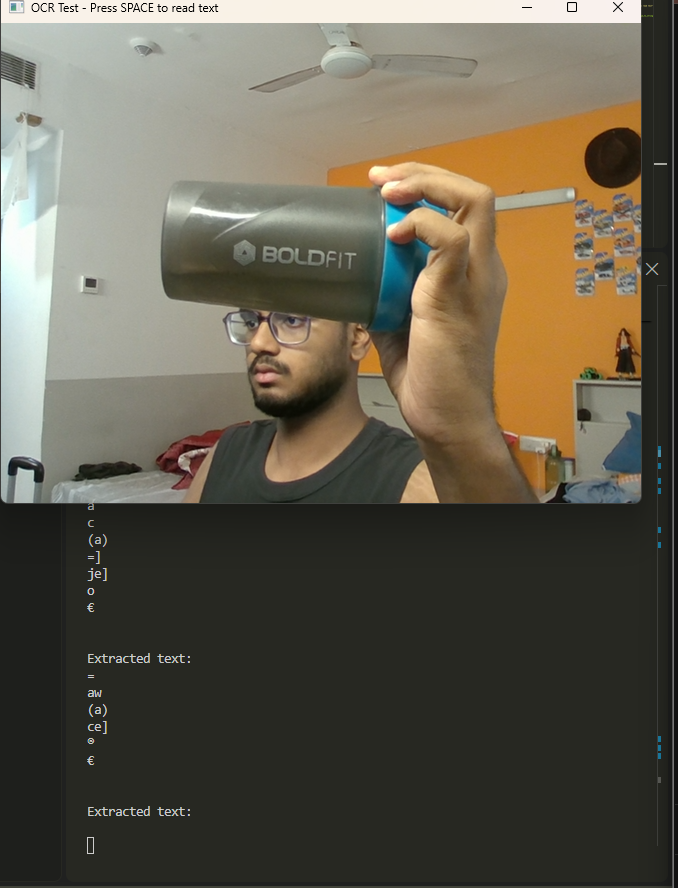
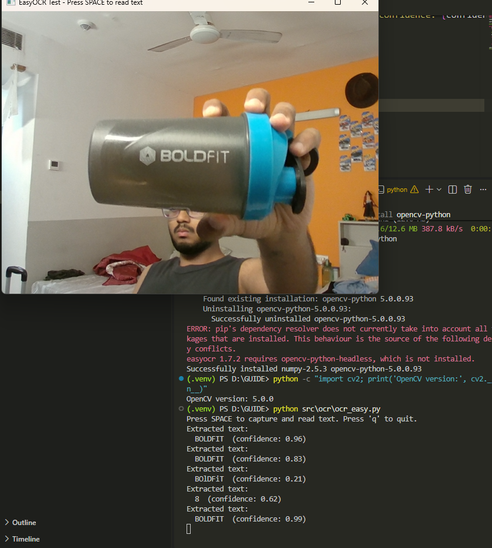
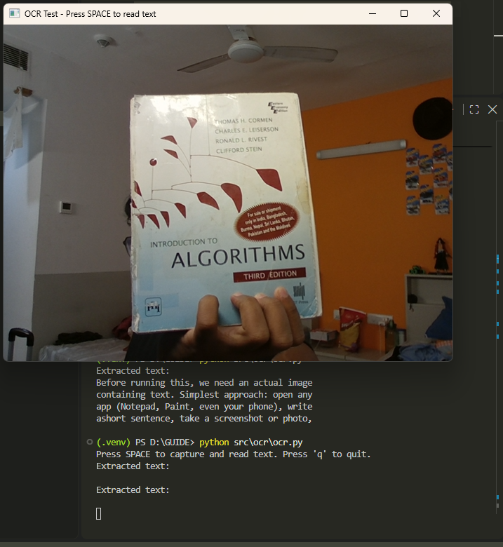
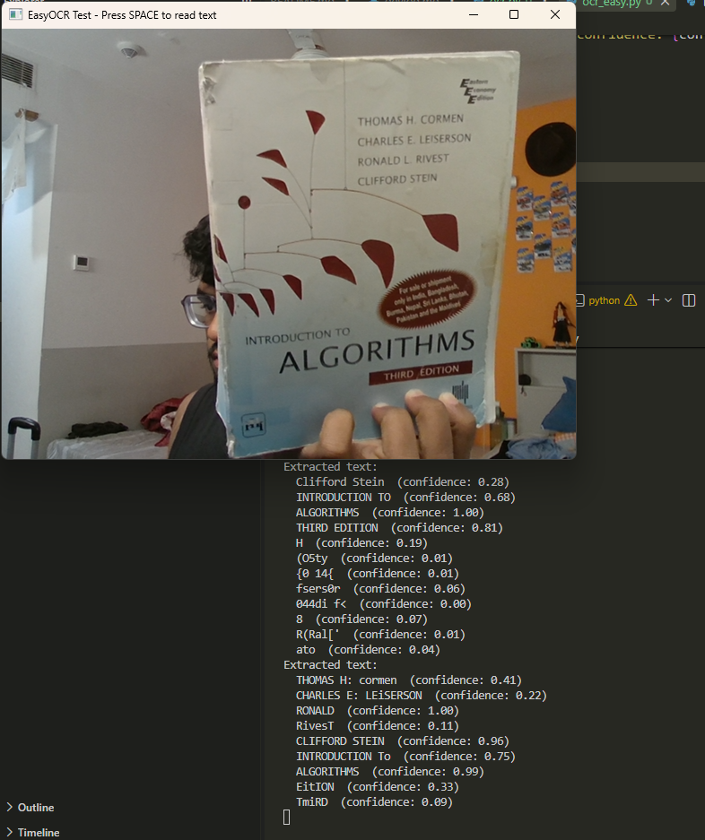

# Development Log

This file tracks daily progress on the Guide  project.
Each entry corresponds to a handwritten diary entry, expanded here in digital form.

---

## Day 0 — [5th sept]

**Goal:** Project foundation setup — no functional code written yet.

**What was done:**

- Installed Git and configured it for Windows
- Cloned the repository locally
- Created project folder structure (`src/detection`, `src/ocr`, `src/currency`,
  `src/speech`, `src/assistant`, `models/`, `experiments/`, `docs/`)
- Created `.gitignore`
- Wrote initial `README.md`
- Created this development log

**What was learned:**
- How Git and GitHub relate to each other (Git is the tool, GitHub is the hosting service)
- What a virtual environment, `.gitignore`, and `src` folder convention are for
- Conducted a research review of the assistive-technology landscape (2024-2026 papers,
  GitHub projects, commercial products) before writing any code

**Next goal:** Day 1 — Python virtual environment and dependency setup.

---

## Day 1 — [6th sept]

**Goal:** Set up an isolated Python virtual environment and verify GPU access.

**What was done:**
- Created a virtual environment (`.venv`) specific to this project
- Installed Ultralytics (YOLO) and OpenCV
- Discovered a fresh install defaults to CPU-only PyTorch
- Reinstalled PyTorch using the nightly build with CUDA 12.8 support,
  required specifically because the RTX 5060 Laptop GPU's architecture
  (Blackwell, compute capability sm_120) is not yet supported by the
  stable PyTorch release
- Verified GPU detection: confirmed working (RTX 5060 Laptop GPU recognized)
- Generated `requirements.txt` to freeze the exact working environment
- Committed and pushed changes to GitHub

**What was learned:**
- The difference between a fresh pip install defaulting to CPU-only builds
  versus explicitly requesting GPU-enabled builds
- Why very new GPU hardware sometimes requires nightly/pre-release software
  builds until official stable support catches up
- What `pip freeze` and `requirements.txt` are for, and why they matter
  for reproducibility

**Problems encountered:**
- Virtual environment creation was interrupted once (`KeyboardInterrupt`),
  requiring deletion and a clean recreation
- Needed to verify whether the installed PyTorch was CPU-only or the
  correct CUDA build before proceeding

**Next goal:** Day 2 — first real object detection code using YOLOv8n.

---

## Day 2 — [6 sept]

**Goal:** Write the first real object detection code and test it on a live webcam feed.

**What was done:**
- Created `src/detection/detect.py`
- First version tested detection on a static sample image (bus.jpg),
  confirming YOLOv8n correctly identified a bus and 3 people with
  confidence scores, running on GPU (4.3ms inference time)
- Rewrote the code to use a live webcam feed instead of a static image,
  using an infinite loop (`while True`) combined with a `break` condition
  triggered by pressing 'q'
- Used Ultralytics' built-in `.plot()` method to automatically draw
  bounding boxes and labels onto each frame
- Organized project files: moved `yolov8n.pt` into `models/`, removed
  the temporary test image
- Committed and pushed the first real working application code

**What was learned:**
- The precise difference between confidence (a model's self-reported
  certainty about one prediction) and accuracy (a measured correctness
  rate against verified ground-truth data across many examples)
- The difference between speed metrics (preprocess/inference/postprocess
  timing) and correctness metrics — these are independent of each other
- Why an infinite loop (`while True`) is necessary for continuous video
  processing, and how `break` provides the only exit condition
- How `cv2.VideoCapture`, `camera.read()`, and `cv2.imshow()` work together
  to build a live video display loop

**Problems encountered:**
- First run failed due to a network interruption during the model
  download (KeyboardInterrupt) — resolved by simply retrying without
  interrupting.

**Next goal:** Day 3 — Measure real-time FPS, test confidence thresholds, document at least one detection failure case.

---

## Day 3 — [ 7 -sept]

**Goal:** Measure real-time FPS, test confidence threshold tradeoffs, document a genuine detection failure case.

**What was done:**
- Added live FPS measurement to `detect.py` using Python's `time` module,
  calculating frame-to-frame processing speed rather than relying only on
  the model's internal inference timing
- Confirmed real-world end-to-end performance: approximately 30 FPS at
  default settings, running fully on GPU
- Tested two confidence thresholds (0.2 and 0.7) on identical surroundings
  to observe the false-positive vs. missed-detection tradeoff directly
- Identified and analyzed a real detection failure case from Day 2's testing

**Experiment Log — Confidence Threshold Comparison**

| Setting | conf = 0.2 | conf = 0.7 |
|---|---|---|
| FPS observed | 27 | 41 |
| Detections shown | 4 (2 correct, 2 false positives) | 1 (correct) |
| False positives | "person 0.27" (empty wall area), "person 0.24" (pile of clothes) | None observed |
| Missed detections | None | Backpack/bed region not labeled at all |
| Conclusion | Lower threshold catches more but introduces false positives; higher threshold is cleaner but risks missing ambiguous objects | |

**Failure Case Analysis**

- **What happened:** A backpack sitting on a bed was labeled "bed" (confidence
  0.46-0.57) instead of being identified as a backpack, or correctly separating
  the two objects.
- **Likely cause:** The bounding box region was likely dominated visually by
  the bedding/blanket pattern, causing the model to classify based on the
  larger surrounding context rather than the smaller foreground object. This
  may also reflect a general known limitation of single-pass detectors like
  YOLO when handling overlapping or partially-occluded objects.
- **Why this matters for the project:** For a blind user relying on this
  system, a misidentified object like this could give inaccurate information
  about their surroundings. This is a genuine limitation to be transparent
  about in the project's documentation, not hidden.

**What was learned:**
- FPS measured end-to-end (capture + detection + drawing + display) differs
  meaningfully from raw model inference time alone, and is the more honest
  real-world performance metric
- Confidence threshold is a genuine tradeoff, not a "more accurate = better"
  setting — the right value depends on whether false positives or missed
  detections are more costly for the specific use case
- Real evaluation requires deliberately looking for failure cases, not just
  showcasing successful detections

**Next goal:** Day 4 — Begin OCR (Optical Character Recognition) for text reading.

---

## Day 4 — [8 sept]

**Goal:** Implement OCR (text reading from images) and achieve reliable
real-world performance.

**What was done:**
- Installed Tesseract OCR engine (standalone C++ program, separate from Python)
  and `pytesseract` as the Python bridge
- Resolved a `TESSDATA_PREFIX` configuration issue where Tesseract's
  compiled-in default path did not match the actual Windows installation
- Built and tested OCR on a static screenshot (successful), then on live
  webcam captures triggered by the space bar
- Found Tesseract failed badly on real-world objects; investigated the
  failure pattern through controlled testing
- Switched to EasyOCR (neural-network-based OCR trained on real-world
  photos rather than scanned documents) and re-tested identical objects
- Resolved an OpenCV conflict caused by EasyOCR installing
  `opencv-python-headless` alongside the standard `opencv-python`

**Experiment Log — Tesseract vs EasyOCR (identical test objects)**

| Test object | Conditions | Tesseract result | EasyOCR result |
|---|---|---|---|
| Saltwater bottle | Curved, high contrast, good lighting | "SALTWATER breeze" — correct | Correct |
| BOLDFIT bottle | Curved, metallic, low contrast | "a c (a) je]" — garbage | "BOLDFIT" (conf 0.99) — correct |
| Algorithms book | Angled, large stylized title font | Empty result — no text returned at all | "ALGORITHMS" (1.00), "INTRODUCTION TO" (0.75), "THIRD EDITION" (0.81), "CLIFFORD STEIN" (0.96) — correct |

**Visual evidence:**

Tesseract failing on the BOLDFIT bottle (metallic, curved, low contrast):

EasyOCR reading the same bottle correctly:

Tesseract failing entirely on the angled book cover (returned no text at all):

EasyOCR reading the same book cover correctly:

**Key finding:** All three objects that completely failed with Tesseract were
read correctly by EasyOCR. The root cause was not curvature alone — the
Saltwater bottle is also curved but worked with both engines — but rather
Tesseract's fundamental design assumption of flat, scanned, document-style
text. EasyOCR, trained on real-world photographs of text, handles curved
surfaces, low contrast, glare, and stylized fonts substantially better.

**Additional observation:** EasyOCR returns per-result confidence scores.
Incorrect/garbage readings consistently carry very low confidence (0.00–0.05),
while correct readings carry high confidence (0.75–1.00), meaning noise can
be filtered by threshold — the same principle applied to object detection
confidence on Day 3. Confidence values are being kept visible during
development for diagnostic purposes rather than filtered out prematurely.

**Problems encountered and resolved:**

| Problem | Cause | Fix |
|---|---|---|
| `TesseractError: Failed loading language 'eng'` | Tesseract's compiled-in default `tessdata` path pointed to a Linux build path that doesn't exist on Windows | Explicitly set `os.environ["TESSDATA_PREFIX"]` to the real installation path |
| `cv2.error: The function is not implemented` on `cv2.imshow()` | EasyOCR installed `opencv-python-headless` (built without GUI support) alongside the existing `opencv-python`, causing a conflict | Uninstalled the headless variant, then force-reinstalled `opencv-python` |
| `ModuleNotFoundError: No module named 'cv2'` | Uninstalling the headless package also removed shared underlying files | `pip install --force-reinstall opencv-python` |

**What was learned:**
- Tesseract is a standalone external program; `pytesseract` is only a bridge,
  not the engine itself — architecturally different from YOLO, which runs
  natively inside Python via PyTorch
- Classical OCR (Tesseract) and neural-network OCR (EasyOCR) have
  fundamentally different robustness characteristics on real-world input
- Diagnosing a failure correctly matters: the initial hypothesis (curvature
  causes failure) was disproven by a counter-example (a curved bottle that
  worked), leading to a more accurate conclusion about contrast, glare,
  and font style being the controlling factors for Tesseract
- Package dependency conflicts can silently break previously-working
  functionality — the same OpenCV that worked fine on Days 2–3 broke purely
  because a new package pulled in a conflicting variant

**Next goal:** Day 5 — Text-to-speech: make OCR and object detection results
speak aloud rather than only printing to terminal, making both features
genuinely usable by the target user for the first time.

---

## Day 5 — [9 sept]

**Goal:** Add text-to-speech output so that OCR and object detection results
are spoken aloud rather than only printed to a terminal — making the project
genuinely usable by its target user (blind and visually impaired people) for
the first time.

**Why this matters:** Every feature built before today printed results to a
terminal window. For a blind user, terminal output is useless. Today is the
first day the project produces output its actual audience can perceive.

**What was done:**
- Installed `pyttsx3`, an offline text-to-speech library that drives SAPI5,
  the speech engine built into Windows
- Built a dedicated, swappable speech module (`src/speech/tts.py`) so that
  changing the TTS engine later requires modifying one file rather than
  every file that produces output
- Integrated speech into OCR: readings above 0.5 confidence are spoken;
  lower-confidence garbage is still printed for diagnostics but not spoken
- Added explicit audible feedback when no text is found ("No readable text
  found"), since silence is ambiguous for a blind user
- Integrated speech into object detection using a change-detection design
  with flicker tolerance
- Diagnosed and resolved four separate speech failures (documented below)

**Design decision — why offline TTS:** `pyttsx3` was chosen over cloud
services (ElevenLabs, Google TTS, Azure) despite lower voice quality,
because it requires no internet connection, no API keys, and no per-use
cost. A blind user should not need connectivity to know what is in front
of them, and images of their private surroundings should not be sent to a
remote server. This aligns with the offline/privacy-first gap identified
during Day 0 research. The speech module is deliberately isolated so a
higher-quality engine (e.g. Piper, which is also offline and supports
Hindi) can replace it later without touching any other file.

**Design decision — change detection for object announcements:** Object
detection runs continuously at ~30 FPS. Announcing every detection every
frame would be unusable. Instead, the system tracks which objects are
currently believed present and announces only newly-appeared objects.
An object must be undetected for 60 consecutive frames (~2 seconds)
before being forgotten and becoming eligible for re-announcement. This
threshold was chosen deliberately: detection flicker typically lasts 1-3
frames, while a genuine removal-and-return takes 1-3 seconds, so the
threshold sits comfortably in the gap between them.

**Errors encountered and resolved:**

**Error 1 — Only the first announcement ever spoke**
- *Symptom:* First `speak()` call worked; all subsequent calls printed
  normally but produced no audio, with no error raised.
- *Diagnosis:* Reproduced in isolation outside the project with a two-word
  test, confirming it was a library behaviour rather than an integration bug.
- *Cause:* After `runAndWait()` completes, pyttsx3's internal event loop
  terminates. The engine still accepts `say()` calls without error, but no
  active loop remains to process them — a silent failure.
- *Fix attempted:* Create a fresh engine per utterance.

**Error 2 — `RuntimeError: run loop already started`**
- *Symptom:* Crashes in worker threads when multiple objects appeared close
  together.
- *Cause:* Spawning one thread per announcement meant multiple pyttsx3
  engines ran concurrently. SAPI5 cannot handle simultaneous speech engines.
- *Fix:* Replaced per-announcement threads with a single permanent worker
  thread consuming from a `queue.Queue`, guaranteeing announcements are
  processed strictly one at a time.

**Error 3 — Threaded speech silently failed regardless of engine strategy**
- *Symptom:* With the queue design, no crashes occurred and diagnostic
  logging confirmed each announcement completed successfully — yet only the
  first produced audio.
- *Diagnosis:* Added `[worker] speaking:` / `[worker] finished:` logging to
  confirm the worker was completing, not hanging. Separately verified via an
  isolated four-word test that repeated create/speak/destroy cycles work
  correctly *on the main thread*.
- *Conclusion:* pyttsx3/SAPI5 does not work reliably from a background
  thread on Windows, most likely due to COM thread-affinity requirements.
  Both persistent-engine and fresh-engine strategies failed identically
  inside a thread while both worked on the main thread.
- *Fix:* Abandoned threading entirely. Switched to pyttsx3's non-blocking
  mode: `engine.startLoop(False)` starts the loop without blocking, and
  `engine.iterate()` processes a small slice of pending speech work each
  time it is called. Calling `iterate()` from within the video loop lets
  speech progress incrementally without ever freezing the loop.

**Error 4 — Speech lagged behind detections and queued up**
- *Symptom:* Announcements were audibly delayed, and a backlog built up when
  several objects appeared at once.
- *Cause:* `iterate()` processes only a small slice of work per call. Calling
  it once per frame was insufficient to keep pace.
- *Fix:* Called `iterate()` five times per frame instead of once. Five was
  chosen as a balance — enough to clear the queue promptly, not so many that
  the video loop slows down.

**Known limitation — repeated announcements for unstable detections:**
Some objects (notably "bed" in testing) are announced repeatedly because
YOLO's confidence in them genuinely fluctuates across frames due to angle,
partial occlusion, and lighting. Increasing `FRAMES_BEFORE_GONE` from 20 to
60 reduced this substantially but did not eliminate it. This is a detection
stability issue rather than a speech or tracking-logic issue. Possible
future mitigations: raising the detection confidence threshold, increasing
the forget threshold further, or adding a per-object cooldown period.

**Known limitation — OCR reading order:** EasyOCR returns text regions in
its own internal processing order, not natural human reading order. When a
book cover is read aloud, fragments are announced in an arbitrary sequence
rather than title-first as a sighted reader would perceive. Raw OCR provides
text but not visual hierarchy or reading order. Possible future approaches:
sorting results by bounding-box position (top-to-bottom, left-to-right),
sorting by text size, or using a language model to organise fragments
meaningfully.

**What was learned:**
- Isolating a bug outside the main program is often the fastest route to a
  correct diagnosis — the two-word and four-word tests each resolved
  ambiguity immediately
- Silent failures are harder than crashes: Errors 1 and 3 raised no
  exceptions and required deliberate diagnostic logging to locate
- Solving one problem can create another: threading fixed the video-freezing
  issue but introduced concurrency crashes, which in turn revealed a
  platform-level threading limitation
- Accessibility design differs from ordinary UI design — silence is
  ambiguous for a blind user, so explicit negative feedback ("no text found")
  is necessary, not optional

**Next goal:** Day 6 — Integration: combine object detection and OCR into a
single application, so both features work together rather than as separate
scripts.